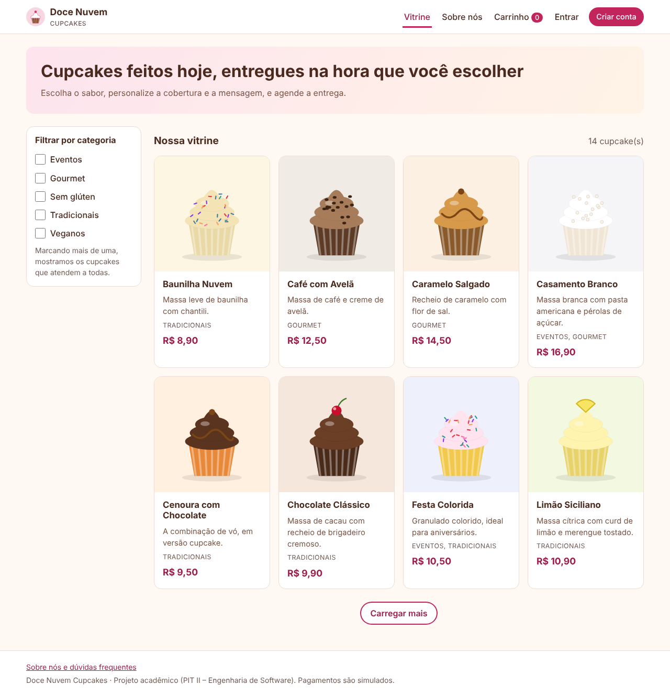

# 🧁 Doce Nuvem Cupcakes

Aplicação web de pedidos de cupcakes com vitrine, personalização, entrega agendada, pagamento (simulado) e rastreamento, além de uma área do gerente para catálogo, pedidos e relatórios.

**Projeto Integrador Transdisciplinar em Engenharia de Software II** · Cruzeiro do Sul Virtual
**Aluno:** Jonathan Soares Guimarães · **RGM:** 32811896



## Funcionalidades

**Cliente**
- Vitrine com rolagem infinita e cupcakes esgotados sinalizados (US01)
- Filtros por categoria, combináveis (US02)
- Personalização: quantidade, cobertura e mensagem de até 50 caracteres (US03)
- Custo total com entrega por CEP, taxa de pedido mínimo e taxa de urgência (US04)
- Pagamento com cartão, Pix ou boleto, **simulado** (US05)
- Agendamento de data e horário dentro do expediente (US06)
- Rastreamento com linha do tempo atualizada a cada 5 s (US07)
- Conta com senha forte (US11) e até 3 endereços com busca de CEP (US15)

**Gerente**
- CRUD de produtos com upload de imagem, categorias e coberturas (US09)
- Gestão de pedidos: confirmar pagamento, avançar status, cancelar com devolução ao estoque
- Relatórios por dia, semana ou mês, com exportação CSV (US10)
- Configuração de horários e taxas

## Tecnologias

PHP 8.1+ (MVC próprio, sem framework) · MySQL 8 / MariaDB · HTML5, CSS3 e JavaScript puro · PHPUnit · Playwright (E2E)

## Como rodar

```bash
cp .env.example .env                       # ajuste DB_USER / DB_PASS
mysql -u root -p -e "CREATE DATABASE cupcakes CHARACTER SET utf8mb4 COLLATE utf8mb4_unicode_ci"
mysql -u root -p cupcakes < database/schema.sql
mysql -u root -p cupcakes < database/seed.sql
php -S 127.0.0.1:8000 -t public server.php
```

Acesse http://127.0.0.1:8000. Instruções para XAMPP, GitHub e hospedagem estão em [docs/implantacao.md](docs/implantacao.md).

| Perfil | E-mail | Senha |
|---|---|---|
| Cliente | cliente@exemplo.com.br | Cliente123 |
| Gerente | gerente@docenuvem.com.br | Gerente@123 |

Cartão de teste aprovado: `4111 1111 1111 1111` · recusado: `4000 0000 0000 0002`

## Testes

```bash
composer install
vendor/bin/phpunit --testdox     # 65 testes: unitários, integração (MySQL) e HTTP
```

Detalhes, matriz de rastreabilidade e resultado em [docs/testes/](docs/testes/README.md).

## Documentação

| Documento | Conteúdo |
|---|---|
| [Revisão do planejamento](docs/01-revisao-do-planejamento.md) | O que mudou desde o PIT I, backlog revisado e status de cada história |
| [UML](docs/uml/README.md) | Casos de uso, classes, sequência, atividades e estados |
| [Banco de dados](docs/banco-de-dados/README.md) | Modelo conceitual, lógico e físico, mais o [dicionário de dados](docs/banco-de-dados/dicionario-de-dados.md) |
| [IHC](docs/ihc/README.md) | Princípios aplicados, navegação, wireframes, telas e mensagens de erro |
| [Arquitetura](docs/arquitetura.md) | MVC, rotas, estrutura de pastas e segurança |
| [Testes](docs/testes/README.md) | Estratégia (Modelo V), execução e rastreabilidade |
| [Manual do usuário](docs/manual-do-usuario.md) | Passo a passo para cliente e gerente |
| [Laudo de qualidade](docs/situacao-3/laudo-de-qualidade.md) | Testes com 5 usuários, defeitos, correções e evidências (versão 1.1) |
| [Implantação](docs/implantacao.md) | Rodar localmente, GitHub e hospedagem |
| [Situação 3](docs/situacao-3/) | Roteiro e formulário para testadores, laudo de qualidade com evidências, roteiros dos vídeos e checklist |

## Estrutura

```
app/          Controllers, Models, Services, Views e Core (MVC)
config/       Rotas
database/     schema.sql e seed.sql
docs/         Documentação
public/       index.php, CSS, JS, imagens e uploads (raiz web)
tests/        PHPUnit (Unit, Integration) e E2E
```

## Limitações conhecidas

O pagamento é simulado. US08 (notificações), US12 (recuperar senha), US13 (avaliações), US14 (cupons) e a confirmação de e-mail ficam para próximas versões. Detalhes em [docs/01-revisao-do-planejamento.md](docs/01-revisao-do-planejamento.md).
