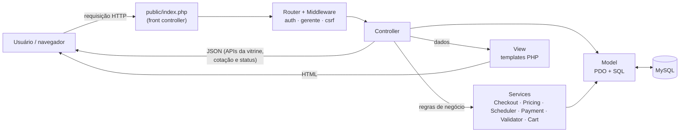

# Arquitetura

## Tecnologias

| Camada | Tecnologia | Por quê |
|---|---|---|
| Front-end | HTML5, CSS3 e JavaScript puro (sem framework) | Leve, sem etapa de build e roda em qualquer hospedagem. |
| Back-end | PHP 8.1+ com **MVC próprio** | Mostra o padrão de forma explícita, sem "mágica" de framework, e roda em hospedagem compartilhada gratuita. |
| Banco de dados | MySQL 8 / MariaDB | SGBD popular, gratuito e disponível em praticamente toda hospedagem PHP. |
| Testes | PHPUnit (unitários e de integração) e Playwright (ponta a ponta, opcional) | |
| Versionamento | Git e GitHub | |

O código de produção **não depende do Composer**: há um autoloader próprio em `app/bootstrap.php`. O Composer só é necessário para instalar o PHPUnit.

## Padrão MVC



- **Model** (`app/Models`): acesso ao banco com PDO e *prepared statements*. Cada classe corresponde a uma tabela ou agregado (por exemplo, `Order` cuida de pedidos, itens e histórico).
- **View** (`app/Views`): templates PHP com layout, *partials* e escape de toda saída com `e()`.
- **Controller** (`app/Controllers`): recebe a requisição, valida a entrada, chama modelos e serviços e escolhe a resposta (HTML, redirecionamento ou JSON).
- **Services** (`app/Services`): regras de negócio puras, sem acesso direto ao HTTP. Assim os controladores ficam enxutos e as regras ficam testáveis.
- **Core** (`app/Core`): infraestrutura (roteador, requisição, sessão, autenticação, middleware, conexão).

## Estrutura de pastas

```
├── app/
│   ├── Controllers/        Controladores (Admin/ = área do gerente)
│   ├── Core/               Roteador, sessão, auth, middleware, view, config
│   ├── Models/             Acesso ao banco (Product, Order, Address...)
│   ├── Services/           Regras de negócio (preço, agenda, pagamento, carrinho)
│   ├── Views/              Templates HTML
│   └── bootstrap.php       Autoloader e configuração
├── config/routes.php       Todas as rotas e seus middlewares
├── database/               schema.sql (projeto físico) e seed.sql (dados de exemplo)
├── docs/                   Documentação (UML, banco, IHC, testes, manual)
├── public/                 Única pasta exposta na web (index.php, CSS, JS, imagens, uploads)
├── storage/logs/           Log de erros (app.log)
├── tests/                  PHPUnit (Unit/, Integration/) e E2E (e2e/)
└── server.php              Roteador para o servidor embutido do PHP (desenvolvimento)
```

## Rotas principais

| Método | Rota | Ação | Acesso |
|---|---|---|---|
| GET | `/` | Vitrine | público |
| GET | `/api/produtos?pagina=&categorias[]=` | Vitrine em JSON (filtros e "carregar mais") | público |
| GET | `/produto/{id}` | Detalhe e personalização | público |
| GET/POST | `/carrinho`, `/carrinho/adicionar`, `/atualizar`, `/remover` | Carrinho | público |
| GET/POST | `/cadastro`, `/login`, `/logout` | Conta | público |
| GET/POST | `/enderecos...` | Endereços | cliente |
| GET | `/checkout`, `/api/checkout/cotacao`, `/api/checkout/horarios` | Checkout e cálculos | cliente |
| POST | `/checkout` | Finaliza o pedido | cliente |
| GET | `/pedidos`, `/pedidos/{id}`, `/api/pedidos/{id}/status` | Histórico e rastreamento | cliente (só os próprios) |
| GET/POST | `/admin...` | Pedidos, produtos, categorias, relatórios, configurações | gerente |

## Segurança

| Ameaça | Proteção |
|---|---|
| SQL injection | PDO com *prepared statements* e `EMULATE_PREPARES = false` |
| XSS | Toda saída passa por `htmlspecialchars` (função `e()`), além de teste automatizado |
| CSRF | Token por sessão em todos os formulários POST (middleware `csrf`) |
| Senhas | `password_hash()` (bcrypt) e mensagem de login genérica |
| Sequestro de sessão | Cookie `HttpOnly` e `SameSite=Lax`, ID regenerado no login |
| Acesso indevido | Middlewares `auth` e `gerente`. Endereços e pedidos sempre filtrados pelo dono |
| Upload malicioso | Tipo verificado pelo conteúdo (finfo), só JPG/PNG de até 2 MB, nome aleatório e `.htaccess` que impede execução em `uploads/` |
| Dados de cartão | Número nunca gravado, apenas os 4 últimos dígitos |
| Exposição de arquivos | Só `public/` é acessível. O `.htaccess` da raiz bloqueia `app/`, `database/`, `.env` etc. |
| Erros | Página amigável ao usuário e detalhes registrados em `storage/logs/app.log` |
