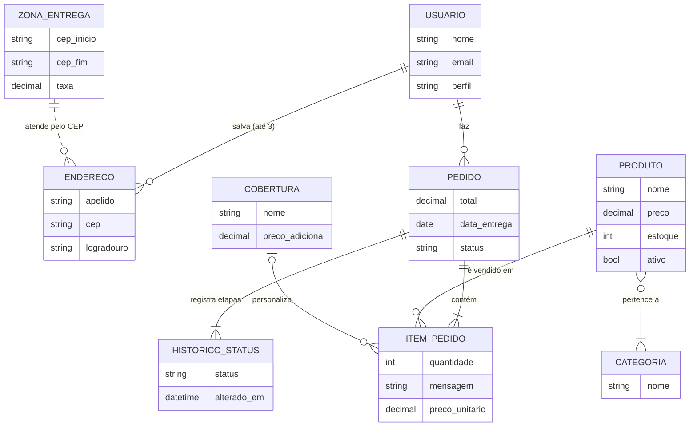

# Projeto de dados

O banco foi derivado do diagrama de classes de persistência ([../uml/README.md](../uml/README.md#2-diagrama-de-classes)) em três níveis: conceitual, lógico e físico.

- **SGBD:** MySQL 8 / MariaDB 10.4+ (InnoDB, `utf8mb4`). É o SGBD mais comum em hospedagens PHP e é gratuito.
- **Script físico:** [`database/schema.sql`](../../database/schema.sql)
- **Dados de demonstração:** [`database/seed.sql`](../../database/seed.sql)
- **Dicionário de dados:** [dicionario-de-dados.md](dicionario-de-dados.md)

## 1. Modelo conceitual (entidade-relacionamento)

A ligação entre zona de entrega e endereço é **lógica** (linha tracejada): a zona é encontrada pela faixa de CEP (`cep BETWEEN cep_inicio AND cep_fim`), sem chave estrangeira. Assim o gerente pode redesenhar as faixas sem mexer nos endereços já cadastrados.

## 2. Modelo lógico (relacional normalizado)

Notação: **sublinhado = PK**, *itálico = FK*.

| Relação | Atributos |
|---|---|
| usuarios | <u>id</u>, nome, email (único), senha_hash, perfil, criado_em |
| enderecos | <u>id</u>, *usuario_id*, apelido, cep, logradouro, numero, complemento, bairro, cidade, uf, criado_em |
| categorias | <u>id</u>, nome (único) |
| produtos | <u>id</u>, nome, descricao, preco, estoque, imagem, ativo, criado_em, atualizado_em |
| produto_categoria | <u>*produto_id*, *categoria_id*</u> |
| coberturas | <u>id</u>, nome (único), preco_adicional, ativa |
| zonas_entrega | <u>id</u>, nome, cep_inicio, cep_fim, taxa |
| configuracoes | <u>chave</u>, valor, descricao |
| pedidos | <u>id</u>, *usuario_id*, endereco_entrega, cep_entrega, subtotal, taxa_entrega, taxa_pedido_minimo, taxa_urgencia, total, data_entrega, hora_entrega, metodo_pagamento, status_pagamento, codigo_pagamento, cartao_final, vencimento_pagamento, status, criado_em, atualizado_em |
| itens_pedido | <u>id</u>, *pedido_id*, *produto_id*, nome_produto, *cobertura_id*, nome_cobertura, mensagem, quantidade, preco_unitario, subtotal |
| historico_status | <u>id</u>, *pedido_id*, status, alterado_em |

### Normalização

- **1FN:** todos os atributos são atômicos. As categorias de um produto, que no PIT I eram uma lista, viraram a tabela associativa `produto_categoria`. O endereço do cliente foi decomposto em campos (CEP, rua, número...).
- **2FN:** nas tabelas com chave composta (`produto_categoria`) não há atributo que dependa só de parte da chave.
- **3FN:** não há dependência transitiva. A taxa de entrega depende da região, e não do endereço, por isso está em `zonas_entrega`. Parâmetros como horário e valor mínimo ficam em `configuracoes`, e não espalhados pelo código.

### Desnormalização intencional (snapshot do pedido)

`pedidos.endereco_entrega`, `itens_pedido.nome_produto`, `nome_cobertura` e `preco_unitario` **repetem** dados que existem em outras tabelas. É uma decisão consciente: o pedido é um documento histórico. Se o gerente mudar o preço do cupcake amanhã, ou o cliente editar o endereço, o pedido de hoje precisa continuar mostrando o que foi efetivamente comprado e cobrado.

## 3. Modelo físico

Principais decisões no [`schema.sql`](../../database/schema.sql):

| Decisão | Motivo |
|---|---|
| `InnoDB` em todas as tabelas | Transações e chaves estrangeiras (integridade referencial). O pedido é gravado numa transação: baixa de estoque + pedido + itens + histórico, ou nada. |
| `DECIMAL(10,2)` para dinheiro | Evita erros de arredondamento de `FLOAT`. |
| `ENUM` para perfil, status e método de pagamento | Restringe o domínio direto no banco. |
| `CHECK (preco > 0)` e `CHECK (quantidade > 0)` | Regras de domínio no próprio SGBD (MySQL 8.0.16+ / MariaDB 10.2+). |
| `UNIQUE` em `usuarios.email`, `categorias.nome`, `coberturas.nome` | RN#2 da US11 e ausência de duplicatas no catálogo. |
| `ON DELETE CASCADE` em endereços, itens e histórico | Excluir o pai remove os dependentes. |
| `ON DELETE RESTRICT` em `itens_pedido.produto_id` e `pedidos.usuario_id` | Impede apagar produto ou cliente com pedidos. O sistema **desativa** o produto em vez de excluí-lo. |
| `ON DELETE SET NULL` em `itens_pedido.cobertura_id` | A cobertura pode sair do cadastro, e o nome continua no item (snapshot). |
| Índices em `pedidos.usuario_id`, `pedidos.criado_em`, `produtos.ativo` e nas FKs | Consultas de "meus pedidos", relatórios por período e vitrine. |
| Senha com `password_hash()` (bcrypt) | Nunca guardar senha em texto puro. |
| Cartão: só os 4 últimos dígitos | CA#3 da US05: dado sensível não é armazenado. |
