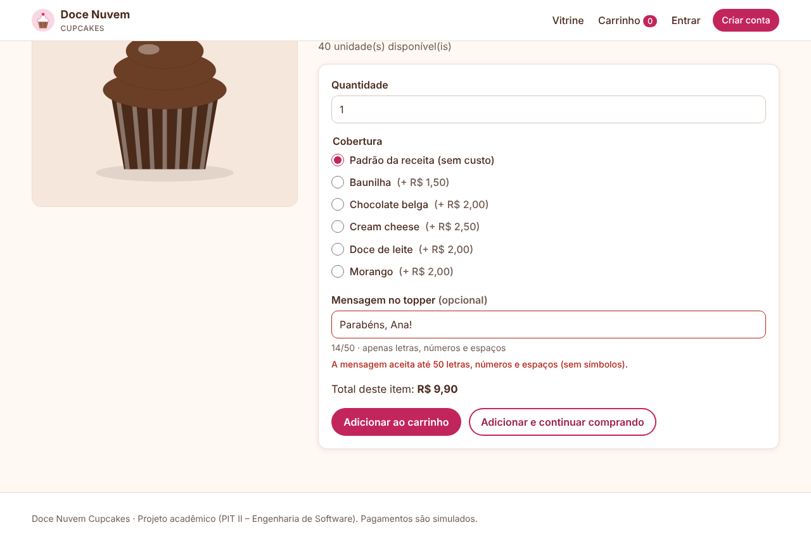
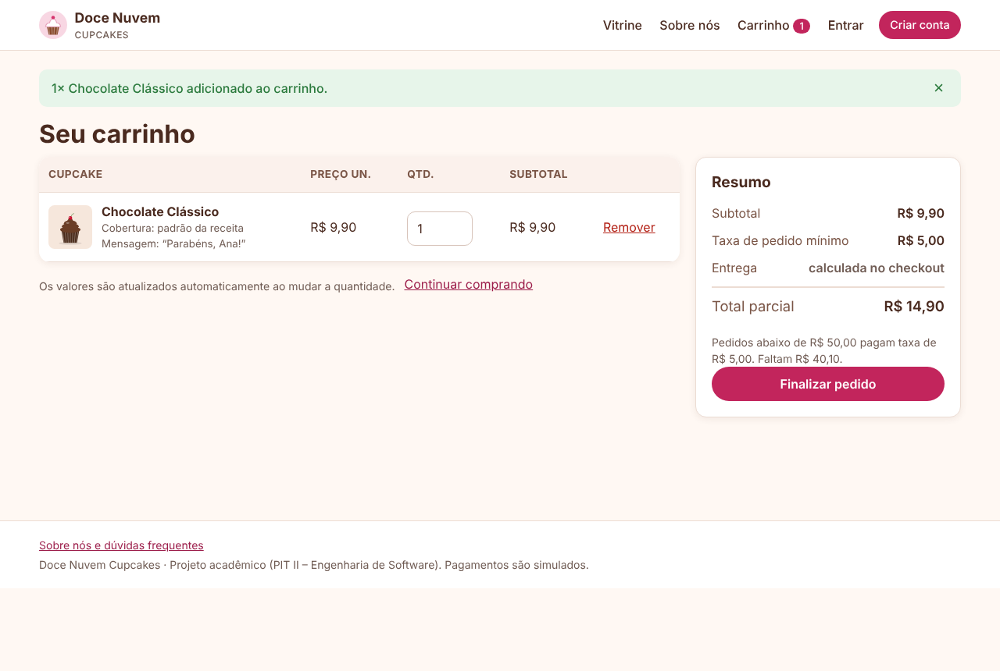
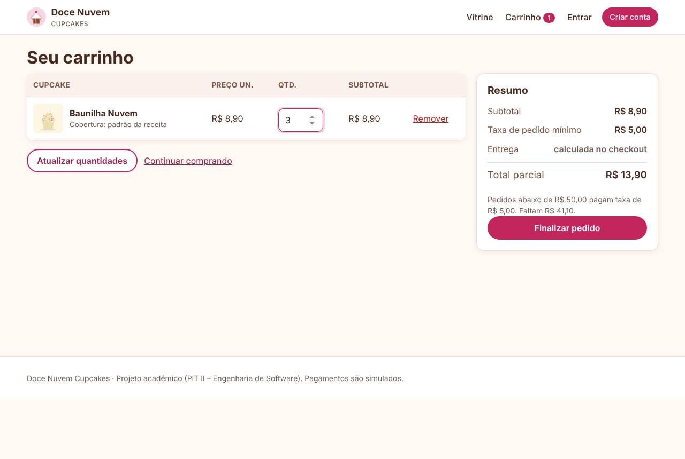
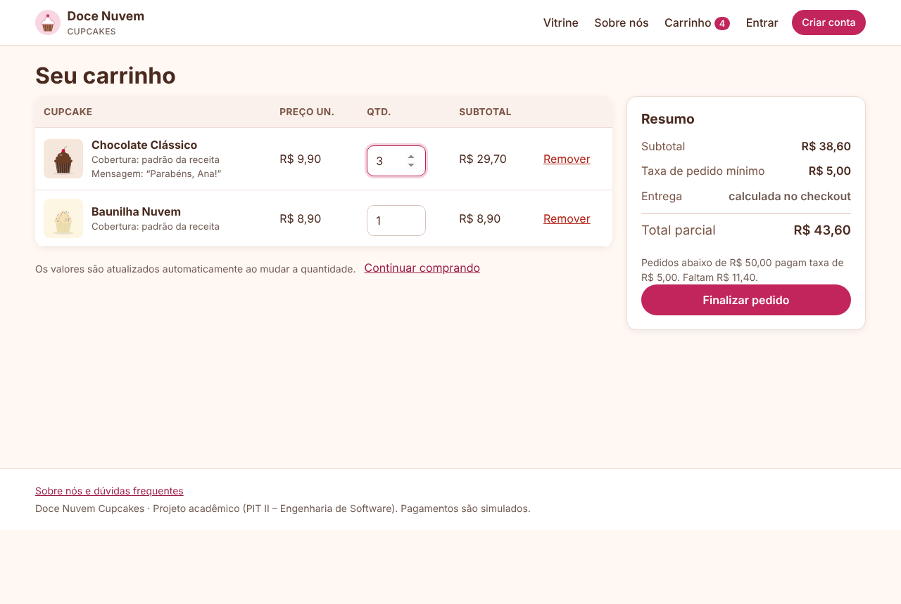
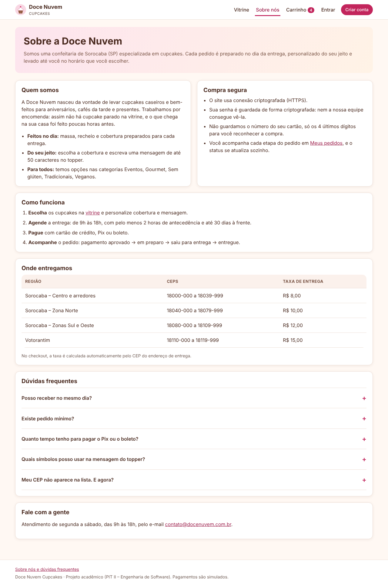

# Laudo de qualidade — Doce Nuvem Cupcakes

**Sistema:** Doce Nuvem Cupcakes · **Versão testada:** v1.0 · **Versão corrigida:** v1.1
**Responsável:** Jonathan Soares Guimarães · **Testes com usuários:** novembro de 2026
**Ambiente testado:** site publicado (https://docenuvem-cupcakes.ifree.page), no celular ou no computador
**Testadores:** 5 pessoas, identificadas aqui pelas iniciais (nomes completos no documento da atividade)

## 1. Método

Cada testador recebeu o link do site e um roteiro curto (cerca de 10 minutos) com o fluxo principal do cliente:

1. Criar uma conta.
2. Escolher 2 cupcakes, personalizar um com mensagem e colocar no carrinho.
3. Cadastrar um endereço de entrega.
4. Finalizar o pedido: primeiro com o cartão recusado (`4000 0000 0000 0002`), depois com o aprovado (`4111 1111 1111 1111`).
5. Conferir o pedido em "Meus pedidos".

Depois, cada um respondeu: o que deu erro, o que ficou confuso, uma nota de 0 a 10 para a facilidade de uso e sugestões de melhoria.

## 2. Resumo

| Indicador | Valor |
|---|---|
| Testadores que concluíram o fluxo de compra | 5 de 5 |
| Funcionalidades avaliadas | Cadastro (US11), vitrine (US01), personalização (US03), carrinho e total (US04), endereço (US15), pagamento com cartão aprovado e recusado (US05), agendamento (US06), Meus pedidos (US07) |
| Defeitos encontrados | 2 (1 funcional, 1 de usabilidade) |
| Defeitos corrigidos | 2 de 2 |
| Sugestões recebidas / adotadas | 1 / 1 |
| Nota média de facilidade de uso | **9,2 de 10** (9, 8, 10, 10 e 9) |
| Testes automatizados após as correções | **65 testes, 220 verificações, 0 falhas** (eram 63 e 206) + teste ponta a ponta sem erros |

## 3. Respostas dos testadores

| Testador | Nota | Erro encontrado | Ponto confuso / sugestão |
|---|---|---|---|
| G. O. | 9 | A mensagem não aceitou o ponto de exclamação "!" | Nada confuso, sem sugestões |
| E. A. | 8 | — | As quantidades do carrinho só mudam depois de clicar em "Atualizar quantidades"; deveria ser automático |
| H. S. | 10 | Nenhum ("gostei de tudo") | Nenhum |
| P. A. | 10 | Nenhum (pedido de 3 cupcakes concluído) | Nenhum |
| P. G. | 9 | Nenhum | Faltam informações sobre a empresa; uma explicação mais detalhada passaria mais credibilidade |

## 4. Defeitos e correções

Gravidade: **Alta** (impede a compra ou causa erro), **Média** (atrapalha, mas há contorno) ou **Baixa** (incômodo de uso, visual ou texto).

| ID | Relatado por | Funcionalidade | Problema | Gravidade | Causa | Correção (v1.1) | Status |
|---|---|---|---|---|---|---|---|
| D01 | G. O. | US03 – mensagem no topper | "Parabéns, Ana!" era recusada: a mensagem só aceitava letras, números e espaços | Média | A regra RN#1 da US03 ("até 50 caracteres alfanuméricos") foi implementada ao pé da letra e ficou restritiva demais para mensagens reais | A regra foi revisada: agora aceita também `. , ! ? ' - : ( ) &`. Continuam bloqueados `< > " / \` (proteção contra HTML/script) e emojis (não saem na impressão do topper). A dica abaixo do campo e a mensagem de erro mostram os caracteres aceitos | ✅ Corrigido |
| D02 | E. A. | US03/US04 – carrinho | Ao mudar a quantidade, subtotal e total só eram recalculados depois de clicar em "Atualizar quantidades" | Baixa | A atualização dependia do envio manual do formulário | O carrinho é enviado em segundo plano 0,5 s depois que a quantidade muda; tabela, resumo e contador do menu se atualizam sem recarregar a página. O cálculo continua no servidor. Sem JavaScript, o botão antigo continua disponível | ✅ Corrigido |

## 5. Sugestões de melhoria

| ID | Sugerido por | Sugestão | Decisão | O que foi feito |
|---|---|---|---|---|
| S01 | P. G. | Explicação mais detalhada sobre a empresa, para passar credibilidade a quem não a conhece | Adotada | Nova página **Sobre nós** (menu e rodapé): quem somos, compra segura (HTTPS, senha criptografada, cartão não armazenado), como funciona, regiões e taxas de entrega e dúvidas frequentes. Horários, taxas e regiões vêm do banco, então mudam junto com as configurações do gerente |

## 6. Funcionalidades não testadas ou não implementadas

| Funcionalidade | Motivo |
|---|---|
| Filtros da vitrine (US02), Pix e boleto (US05) | Fora do roteiro curto enviado; cobertas pelos testes automatizados e pelo teste ponta a ponta |
| Área do gerente: status do pedido, catálogo, relatórios (US07, US09, US10) | Fora do roteiro; cobertas pelos testes automatizados e pelo teste ponta a ponta |
| US12 Recuperar senha | Não implementada (exige envio de e-mail) |
| US08 Notificações push/e-mail | Não implementada; a página do pedido se atualiza sozinha |
| US13 Avaliações / US14 Cupons | Não implementadas (prioridade C, no backlog) |

## 7. Evidências

Os prints de "antes" reproduzem no ambiente de desenvolvimento, com a versão 1.0, o que os testadores relataram. Os de "depois" foram tirados com a versão 1.1.

**D01, antes:** a mensagem "Parabéns, Ana!" é recusada.

**D01, depois:** a mesma mensagem entra no carrinho.

**D02, antes:** a quantidade foi mudada para 3, mas o subtotal continua R$ 8,90 até clicar no botão.

**D02, depois:** com a quantidade em 3, subtotal (R$ 29,70), resumo e contador do menu se atualizam sozinhos; o botão deu lugar a um aviso.

**S01, antes:** o menu não tinha nenhuma página sobre a empresa.

**S01, depois:** item "Sobre nós" no menu e a nova página.

No celular: [carrinho](evidencias/d02-depois-celular.png) · [Sobre nós](evidencias/s01-depois-celular.png).

## 8. Conclusão

Os 5 testadores concluíram o fluxo completo de compra, inclusive a recusa e a aprovação do cartão, e deram nota média de 9,2 de 10 para a facilidade de uso. Não houve defeito que impedisse a compra. Os dois problemas relatados (pontuação na mensagem e atualização manual do carrinho) foram corrigidos, e a sugestão de mais informações sobre a empresa foi adotada com a página "Sobre nós". Cada correção ganhou testes automatizados (65 testes, 0 falhas). As histórias de prioridade C (US08, US12, US13, US14) seguem no backlog da próxima versão.
