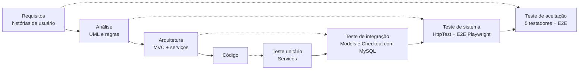

# Plano e resultados de testes

## 1. Estratégia (Modelo V)



| Nível | O que testa | Ferramenta | Onde |
|---|---|---|---|
| Unitário | Regras puras: preço, agenda, pagamento, carrinho, validações | PHPUnit | `tests/Unit` |
| Integração | Models e checkout com banco MySQL real (recriado a cada teste) | PHPUnit | `tests/Integration/*Test.php` |
| Sistema | Requisições HTTP reais: rotas, permissões, CSRF, XSS, CSV | PHPUnit + servidor embutido do PHP | `tests/Integration/HttpTest.php` |
| Ponta a ponta | Fluxos completos no navegador, com capturas de tela | Playwright (Python) | `tests/e2e/fluxo_completo.py` |
| Aceitação | Uso real por 5 pessoas | Formulário e laudo | `docs/situacao-3/` |

### Verificação × validação

- **Verificação** ("construímos certo?"): revisão do código contra as histórias e as regras de negócio, mais os testes unitários e de integração, que conferem cada critério de aceitação e regra.
- **Validação** ("construímos a coisa certa?"): testes ponta a ponta e, principalmente, os **5 testadores** da Situação 3, que usam o sistema como clientes reais.

## 2. Como executar

```bash
# 1. Banco de testes (uma vez)
mysql -u root -p -e "CREATE DATABASE cupcakes_test CHARACTER SET utf8mb4 COLLATE utf8mb4_unicode_ci;"
#    Ajuste usuário e senha do banco no phpunit.xml, se necessário.

# 2. Instalar o PHPUnit e rodar
composer install
vendor/bin/phpunit --testdox

# Só os unitários (não precisam de banco)
vendor/bin/phpunit --testsuite Unit
```

Teste ponta a ponta (opcional), com o servidor rodando e o banco recém-populado:

```bash
pip install playwright && playwright install chromium
php -S 127.0.0.1:8000 -t public server.php     # em outro terminal
python tests/e2e/fluxo_completo.py
```

## 3. Resultado da última execução

**63 testes, 206 verificações (asserções), 0 falhas.** Saída completa em [resultado-phpunit.txt](resultado-phpunit.txt).

O teste ponta a ponta percorreu os fluxos do cliente e do gerente **sem erros de JavaScript** e gerou as capturas em [`docs/ihc/telas/`](../ihc/telas/).

## 4. Matriz de rastreabilidade (história → testes)

| História / regra | Teste(s) automatizado(s) |
|---|---|
| US01 vitrine, paginação, esgotados no fim | `ProductTest::testVitrinePaginadaComIndisponiveisNoFim`, `HttpTest::testApiDaVitrineRespondeJson`, E2E |
| US02 filtros combinados | `ProductTest::testFiltroCombinado`, E2E (2 → 1 resultado) |
| US03 personalização e mensagem ≤ 50 | `ValidatorTest::testMensagemDoCupcake`, `CartTest::*`, `PricingServiceTest::testPrecoUnitarioComCobertura`, E2E |
| US04 custo total, taxa de mínimo, CEP fora da área | `PricingServiceTest::*`, `CheckoutServiceTest::testPedidoPequenoNoMesmoDiaCobraTaxas`, `testCepForaDaAreaDeEntrega` |
| US05 cartão (Luhn, validade, CVV, recusa), Pix 10 min, boleto 2 dias úteis, sem guardar o cartão | `PaymentSimulatorTest::*`, `CheckoutServiceTest::testCartaoRecusadoNaoCriaPedidoNemBaixaEstoque` |
| US06 expediente, antecedência, urgência | `DeliverySchedulerTest::*`, `CheckoutServiceTest::testHorarioForaDoExpedienteERecusado` |
| US07 status sem pular etapas, histórico, cliente só vê os próprios | `OrderTest::*`, `HttpTest::testAreasRestritasExigemLogin`, E2E |
| US09 CRUD, categorias, remoção preserva histórico, só gerente | `ProductTest::testCriarEditarProdutoComCategorias`, `testRemoverProdutoUsadoEmPedidoApenasDesativa`, `HttpTest::testClienteNaoAcessaAreaDoGerente` |
| US10 relatório só com pedidos válidos, CSV | `OrderTest::testRelatorioConsideraApenasPedidosValidos`, `HttpTest::testGerenteExportaRelatorioCsv` |
| US11 senha forte, hash, e-mail único | `ValidatorTest::testRegraDeSenha`, `UserAndAddressTest::testSenhaGuardadaComoHash`, `testEmailUnico` |
| US15 CEP, endereço só do dono | `ValidatorTest::testCep`, `testEnderecoComErros`, `UserAndAddressTest::testEnderecoPertenceAoDono`, `CheckoutServiceTest::testNaoUsaEnderecoDeOutroCliente` |
| Estoque na compra (transação) | `CheckoutServiceTest::testEstoqueInsuficienteNaoCriaPedido`, `OrderTest::testCancelamentoDevolveEstoque` |
| Segurança: CSRF, XSS, login genérico | `HttpTest::testPostSemTokenCsrfERecusado`, `testCadastroEscapaHtml`, `testLoginInvalidoMostraMensagemGenerica` |

## 5. Limitações conhecidas (para o laudo)

- O pagamento é **simulado**: não há cobrança real.
- O código Pix expira em 10 minutos apenas como informação. Não há cancelamento automático do pedido; o gerente confirma o pagamento manualmente.
- As faixas de CEP atendidas são exemplos (região de Sorocaba) e são cadastradas direto no banco.
- A consulta ao ViaCEP depende de internet. Sem ela, o cliente preenche o endereço manualmente.
- Histórias US08, US12, US13 e US14 e a confirmação de e-mail (US11 CA#2) não foram implementadas nesta versão.
