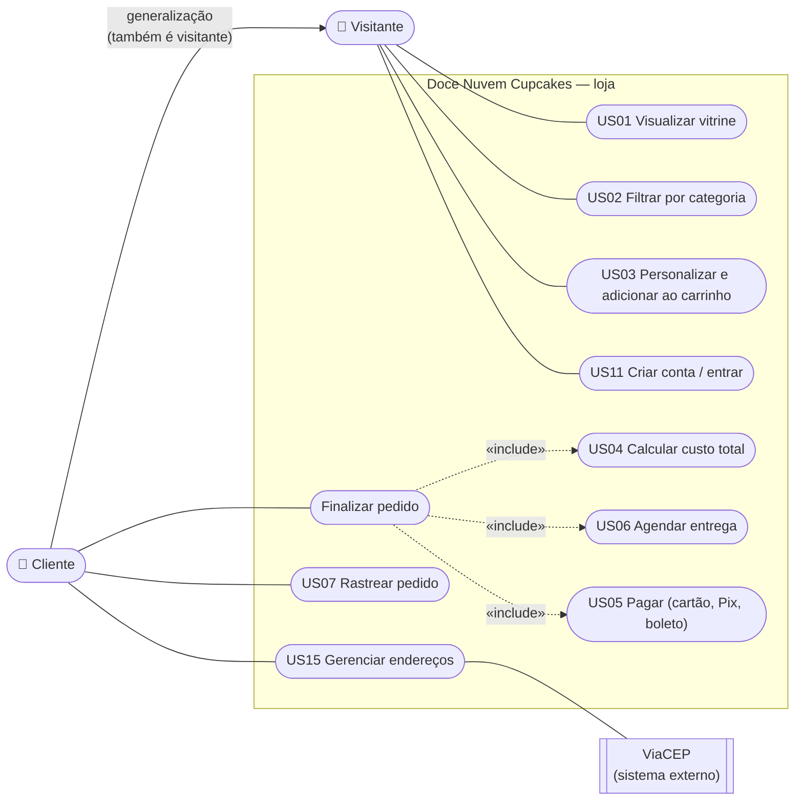
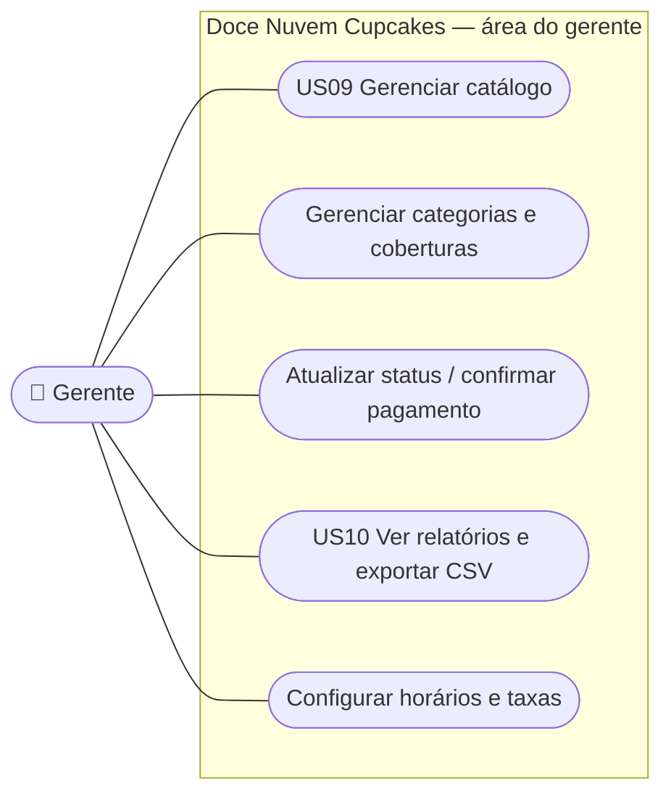
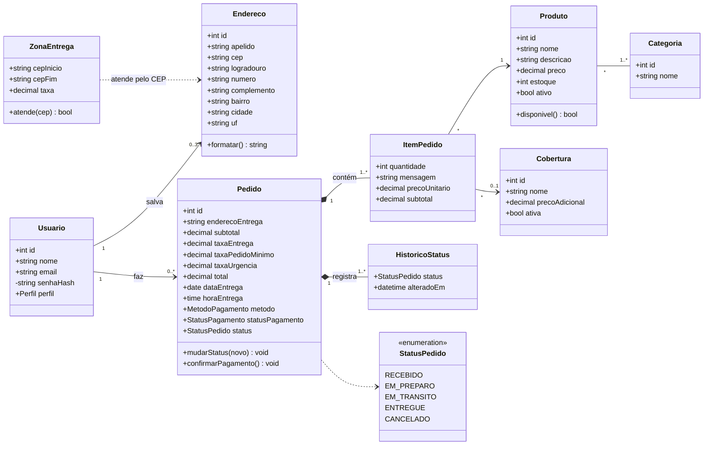
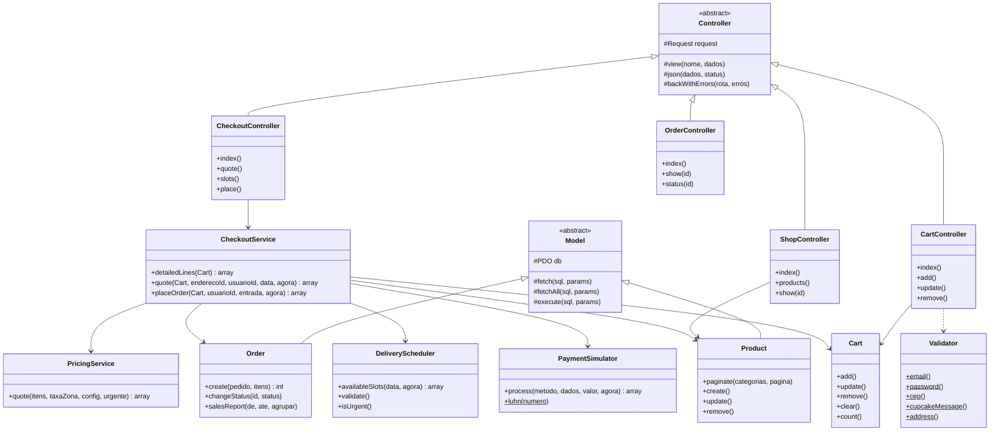
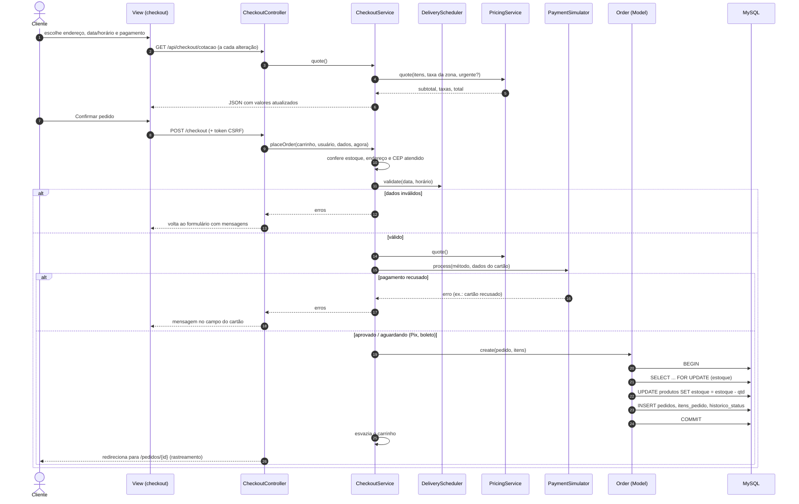
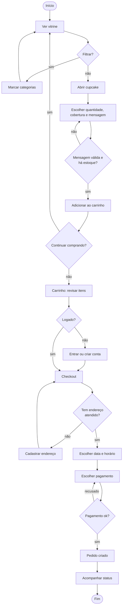
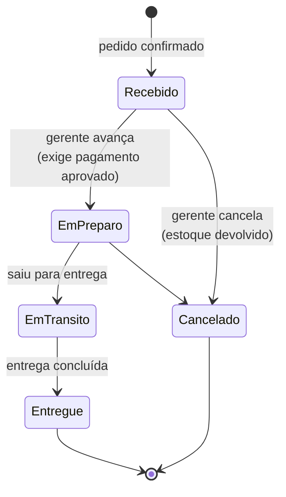

# Modelagem UML (revisada)

Os diagramas estão em Mermaid, que o GitHub desenha automaticamente. As versões em imagem ficam em [`imagens/`](imagens/).

Revisão em relação ao PIT I: o PIT I tinha apenas as histórias de usuário e o backlog. Aqui eles viraram diagramas que refletem **o que foi implementado** (ver [../01-revisao-do-planejamento.md](../01-revisao-do-planejamento.md)).

## 1. Diagrama de casos de uso

### 1.1 Cliente e visitante

### 1.2 Gerente

**Atores**
- **Visitante:** navega pela vitrine e monta o carrinho sem precisar de conta.
- **Cliente:** visitante autenticado. Finaliza pedidos, salva endereços e acompanha entregas.
- **Gerente:** administra catálogo, pedidos, relatórios e parâmetros de negócio.

## 2. Diagrama de classes

### 2.1 Classes de domínio (persistência)

### 2.2 Classes da aplicação (MVC + serviços)

Os serviços (`PricingService`, `DeliveryScheduler`, `PaymentSimulator`, `Validator`, `Cart`) **não acessam o banco**. Recebem dados e devolvem resultados, por isso são testados de forma isolada (testes unitários).

## 3. Diagrama de sequência — finalizar pedido

## 4. Diagrama de atividades — compra do cliente

## 5. Diagrama de estados — pedido

As transições são validadas no modelo `Order::changeStatus()`. Não é possível, por exemplo, ir de "Recebido" direto para "Entregue" (RN#1 da US07).
